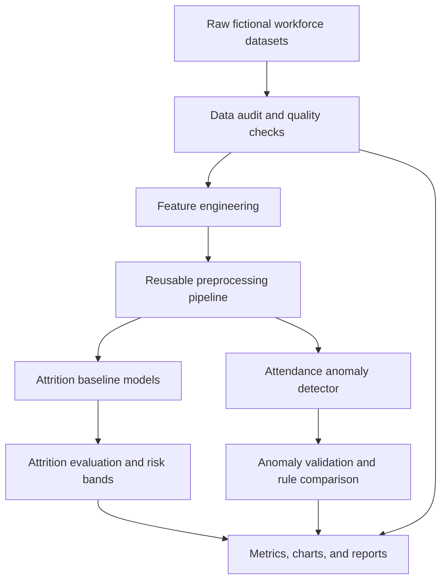

# CortexHR Phase 1 — Architecture

## Overview

The Phase 1 workflow converts workforce data into auditable features, baseline model results, and evaluation evidence.

## Workflow

## Components

- **Data audit:** examines data quality, duplicate records, invalid values, target distribution, and potential leakage.
- **Feature engineering:** prepares model-ready numeric and categorical features and monthly attendance/payroll aggregates.
- **Attrition baselines:** compares a Dummy baseline, Logistic Regression, and a Decision Tree.
- **Attrition evaluation:** documents classification metrics, probability calibration, and risk bands.
- **Attendance anomaly detection:** evaluates Isolation Forest and rule-based detection against the available labelled anomaly examples.
- **Evidence:** stores metrics, charts, and Markdown reports under `reports/`.

## Current scope

This diagram describes the implemented Phase 1 workflow. It does not claim that the later-phase API, hosted console, or public deployment is complete.
